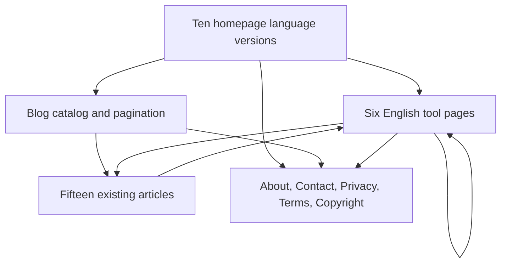

# SaveFrame SEO implementation report

**Date:** 24 October 2026 (Asia/Colombo). **Configured production origin:** https://saveframe.site. **Verification environment:** local production-mode Next.js server at http://localhost:3000. No live VPS, DNS, certificate or Search Console changes were made.

The implementation fixes discovery and missing-page issues while preserving the approved homepage design, existing language and blog URLs, and the yt-dlp/FFmpeg backend. Six functional tool pages and five information pages were added. The final crawl checks 38 indexable pages: 37 sitemap URLs plus the second blog listing page.

## 1. Initial problems and priorities

The baseline audit is preserved in [SEO_INITIAL_FINDINGS.md](SEO_INITIAL_FINDINGS.md) and [reports/seo-initial-crawl.json](reports/seo-initial-crawl.json).

| Priority | Initial evidence | Implementation and result |
|---|---|---|
| High | All six intended feature URLs returned 404. Tool names were mostly buttons with no href. | Added functional English tool pages and standard links in the existing menus, footer and contextual content. All six return 200. |
| High | About, Contact, Privacy, Terms and Copyright URLs returned 404. Legal information depended on JavaScript dialogs. | Added five server-rendered pages, retained legacy dialog/query compatibility, and linked the pages from every footer. |
| High | Contact dialog used unverified saveframe.app mailboxes and promised a one-business-day response. | Replaced with user-approved backbencherz@gmail.com for both support and copyright. Removed the response-time promise. |
| High | API exclusion relied on robots disallow alone. | Added X-Robots-Tag: noindex, nofollow, nosnippet to API responses; retained robots restrictions and sitemap exclusion. This is not a claim that a robots-blocked URL's header can be read by Google. |
| Medium | Homepage source lacked WebSite/WebPage/application JSON-LD and a social image. | Added factual graphs, localized homepage metadata and a 1200×630 branded social image. Rendered schema was inspected in a browser. |
| Medium | Blog page two canonicalized to page one despite listing different articles. | Unfiltered pagination is self-canonical and indexable, with a distinct title and description. Search and category filters remain noindex. |
| Medium | Fixed photo-size maximum claims disagreed with actual larger downloaded source images. | Updated the visible table and quality FAQ in all ten dictionaries to describe source-dependent dimensions without upscaling promises. |
| Medium | The Nginx example named saveframe.app and served HTTP only. | Corrected the origin and prepared a separate TLS/non-www example retaining API rate limits and proxy behavior. Not deployed or tested with a real certificate. |
| Low | Blog tool links used query parameters, CTA labels were generic, and the article breadcrumb ended with a category instead of the article. | Renderer and CTAs now link to canonical tools, card links have descriptive accessible labels, and visible breadcrumbs match the article trail. |

Existing strengths retained: ten server-rendered homepage languages, reciprocal hreflang, fifteen substantive articles, unique generated WebP covers, actual downloadable media, no fake reviews and explicit access limitations.

## 2. Keyword mapping and search intent

No keyword volumes, difficulty scores, rankings or traffic forecasts were available or invented.

| Page | Primary topic | Natural supporting queries | Distinct purpose |
|---|---|---|---|
| `/` and nine language equivalents | instagram downloader | save Instagram media | General tool selection and introduction; translated versions are language alternatives. |
| `/reels-downloader` | instagram reels downloader | download instagram reels; instagram reels download | Prepare a specific short-form clip; explain video/audio options. |
| `/video-downloader` | instagram video downloader | download instagram videos; instagram video download | Feed and older video-post links, file delivery and playback. |
| `/photo-downloader` | instagram photo downloader | download instagram photos; instagram image downloader | Individual photo files and available dimensions. |
| `/carousel-downloader` | instagram carousel downloader | download multiple instagram photos | Slide-by-slide inspection, item downloads and ordering. |
| `/story-downloader` | instagram story downloader | download instagram stories | Active story URLs, expiration and access restrictions. |
| `/profile-viewer` | instagram profile viewer | instagram profile picture viewer | Available public profile metadata and avatar limitations. |
| `/blog` and `/blog?page=2` | Instagram download guides | device instructions and troubleshooting | Editorial discovery, not duplicate tool landing pages. |
| `/blog/[slug]` | Specific how-to questions | MP4, iPhone, audio, copying links, carousel order | Step-by-step explanation supporting the relevant tool. |

Five broad article keyword fields were refined to instructional queries, for example “how to download instagram reels in mp4,” rather than giving the tool and its guide identical target phrases. Article titles, body copy and published URLs were preserved. No new overlapping articles were produced.

## 3. Architecture and navigation

```text
Homepage (/), with /es/, /pt-br/, /de/, /fr/, /ja/, /id/, /tr/, /hi/, /ar/
├── Reels downloader (/reels-downloader)
├── Video downloader (/video-downloader)
├── Photo downloader (/photo-downloader)
├── Carousel downloader (/carousel-downloader)
├── Story downloader (/story-downloader)
├── Profile viewer (/profile-viewer)
├── Blog (/blog, /blog?page=2)
│   └── Fifteen existing articles (/blog/[slug])
├── About (/about)
├── Contact (/contact)
├── Privacy (/privacy)
├── Terms (/terms)
└── Copyright (/copyright)
```



Header menus keep their existing appearance and order. Tool menu items now use anchors with href attributes; the logo links to the current language homepage. The five interactive media tabs stay on the homepage as before. On a dedicated tool page, switching to another tool navigates to that tool's URL. Carousel uses the existing photo/carousel engine, not a fabricated sixth backend mode.

Footer columns retain their styling. About and Copyright were added to Legal & Support, and existing legal/support labels point to real pages. Tool pages include links to their sibling tools and three relevant guides. Blog renderers convert existing `/?tool=...#main-tool` body links to the corresponding dedicated paths without rewriting the Markdown bodies. Existing query URLs still work for bookmarks; no established page was renamed or removed.

This is an additive URL change, not a migration: new tool and information paths were 404 before implementation. No redirects from existing functioning pages were needed. Existing locale trailing slashes and non-locale paths without trailing slashes are preserved.

## 4. On-page and content changes

- Each tool has its own H1, metadata, introduction, practical instructions, access limitations, three relevant FAQs and guide links. The existing form, tabs, preview, format selection and download jobs are reused.
- Photo copy explains available source dimensions rather than claiming an original camera master. Reels and videos distinguish containers, tracks and sound. Carousel now explains individual downloads and the verified Download all ZIP option. Stories and profiles explicitly reject private access and guaranteed high resolution.
- About describes the actual service without invented staff, qualifications, business addresses or affiliations. Privacy describes submitted URLs, temporary jobs/files, technical logs, Google Fonts, previews and clipboard behavior. Contact and copyright pages use the approved public email.
- All fifteen articles were reviewed by topic and retained. Metadata keywords, rendered internal links, CTA targets, accessible card labels and breadcrumb presentation were improved. Publication dates were not artificially refreshed for template-only changes.
- The updated homepage table/FAQ claims and two new footer labels are translated across all ten dictionaries. The shared system now has 244 keys per language. Tool and legal pages remain English; no non-existent translated versions are advertised.

## 5. Technical SEO and structured data

The 37 sitemap entries comprise ten homepages, six tools, five information pages, the blog index and fifteen articles. The second blog listing is discoverable through ordinary pagination and has its own canonical; it need not appear in the sitemap. Draft articles, query filters, APIs, job URLs and temporary files are excluded. Existing robots behavior and access to rendering resources are preserved.

Homepages retain all ten self-referencing language alternatives plus x-default; canonical and language targets agree with the configured origin. Every new public page has a title, description, canonical, robots directive, Open Graph and Twitter metadata. Unknown paths have a useful noindex 404 with links to working pages. API noindex is verified on health and missing-job responses; the download endpoints remain operational.

New page graphs use Organization, WebSite and WebPage. Tool/home graphs also describe a WebApplication, and non-home pages include BreadcrumbList. Existing BlogPosting and article BreadcrumbList markup remain. Entity descriptions use actual visible content; no reviews, ratings, awards, user counts, fabricated offers or third-party affiliations were added. No HowTo schema or promised FAQ rich-result shortcut is used. WebApplication markup is descriptive; software-app rich-result eligibility is not claimed without the additional applicable Google requirements.

Local validation checks JSON parsing, schema types, required identifying fields, absolute URLs, breadcrumb order, article dates and image/author fields. Rendered DOM schema was separately inspected on the Reels page. Google Rich Results Test and Schema.org's hosted validator were not run against localhost; test deployed URLs there before requesting indexing.

## 6. Performance review

- Existing compressed, responsive WebP images and intrinsic dimensions remain in place. No new homepage hero image or image-generation dependency was introduced.
- Next Image output widths are bounded to the existing 1200px source maximum. Blog-image cache headers allow one day of caching with stale-while-revalidate; filenames should be versioned when replacing an image.
- Existing font preconnects and display=swap are preserved, along with the approved typography and script fallbacks.
- The social card is 1200×630 PNG, 38,806 bytes, generated from an original SVG matching the existing brand palette.
- Final production build reports approximately 105 kB first-load JS for `/`, 109 kB for the shared localized/tool route and 112 kB for blog pages. No new package dependency was installed.
- LCP, INP, CLS, Lighthouse scores, field data and mobile network timings were not measured. Local crawl response-and-body timings in the JSON report are diagnostic timings, not Core Web Vitals or production speed evidence. Measure deployed pages with PageSpeed Insights and Search Console when available.

## 7. Files created and modified

**Created:** `SEO_INITIAL_FINDINGS.md`; this report; `reports/seo-initial-crawl.json`; `reports/seo-crawl.json`; `scripts/check-seo.cjs`; `src/content/tools.json`; `src/content/information.json`; `src/lib/navigation.ts`; `src/lib/seo.ts`; `src/lib/tool-page.ts`; `src/components/InformationPage.tsx`; `src/app/not-found.tsx`; `public/social/saveframe.svg`; `public/social/saveframe.png`; `nginx/saveframe-tls.conf.example`.

**Modified:** `src/app/[locale]/page.tsx`; `src/app/blog/page.tsx`; `src/app/blog/[slug]/page.tsx`; `src/app/sitemap.ts`; `src/i18n/homepage.ts`; `src/i18n/server.ts`; all ten `src/i18n/dictionaries/*.json`; `src/content/blog/posts.json`; `src/components/blog/BlogShell.tsx`; `src/components/blog/ArticleCard.tsx`; `src/components/blog/Markdown.tsx`; `public/saveframe.js`; `next.config.ts`; `.env.production`; `.env.example`; `nginx/saveframe.conf`; `package.json`; `README.md`; `scripts/check-i18n-live.cjs`; `scripts/check-blog-live.cjs`.

No downloader service, API route, media extractor, security validator, FFmpeg processing code, blog Markdown file or existing UI template was rewritten. Existing colors, typography, homepage section layout and animations were preserved.

## 8. Actual verification results

| Check | Actual result |
|---|---|
| `npm run test:i18n` | Pass: ten complete 244-key dictionaries, placeholders, rendered markup, metadata and runtime translation checks. |
| `npm run test:blog` | Pass: fifteen full articles, 16,819 words, unique covers, heading anchors, internal source links and related content. |
| `npm run test:downloader` | Pass: cache reuse, video/audio merge selection, photo carousels, truthful metadata and cleanup checks. |
| `npm run build` | Pass on final implementation. |
| `npm run test:seo` | Pass: 38 indexable pages, unique titles/descriptions, one H1, canonicals, schema, social tags, 51 internal destinations, fragment targets, API noindex, contact, robots, sitemap and 404. |
| `node scripts/check-i18n-live.cjs` | Pass: ten language URLs, SSR translations, lang/dir, reciprocal alternatives, canonical slash redirects and English blog isolation. |
| `node scripts/check-blog-live.cjs` | Pass: fifteen article URLs, missing article 404, search, categories, pagination and structured data. |
| `npx tsc --noEmit` | Fails on the pre-existing `src/tests/backend.test.ts:15` import of missing `../server`. No new SEO type errors were reported. |
| `npm run lint` | Not a passing check: existing ESLint configuration is absent and next lint opens setup. No setup choices were silently made. |
| Browser and real media | Reels page rendered correct H1/canonical and Organization/WebSite/WebPage/WebApplication/BreadcrumbList DOM schema; a real Reel resolved and completed its download. Photo-tab navigation reached `/photo-downloader`; 390px mobile layout had no horizontal overflow and the menu opened. |

The machine-readable final inventory includes all inspected titles, descriptions, schema types and checked destinations: [reports/seo-crawl.json](reports/seo-crawl.json). All results above are local. The public domain could not be accessed with the web tool during this task, and no claim is made about its current deployment, indexing or rankings.

## 9. Remaining issues and deployment requirements

1. Deploy the final build through the existing release process; no deployment was performed. Include content, dictionaries and public assets in the runtime package, plus working yt-dlp/FFmpeg installations and temporary storage.
2. Keep NEXT_PUBLIC_SITE_URL set to https://saveframe.site before building. Both configured public email variables use backbencherz@gmail.com as authorized by the user.
3. Review and apply the TLS/non-www example only after verifying the actual upstream, certificate paths, rate-limit requirements and ACME setup. It is a local example; no nginx reload or certificate operation was performed.
4. Resolve the old standalone backend-test import and configure ESLint independently. They remain repository setup issues; passing production compilation does not mean these commands passed.
5. Confirm the privacy description against real hosting logs and any analytics/advertising integrations before release. No unverifiable zero-logging, response-time or private-media promises are published.
6. Validate production headers, redirects, canonical tags, robots, sitemap, social-card fetching and JSON-LD after deployment. API robots blocking and noindex headers are complementary controls, not proof that previously indexed API URLs have already disappeared.
7. Production Core Web Vitals, backlinks, organic traffic, indexed URLs and Search Console data remain unverified. Instagram's access and rate restrictions still apply.

## 10. Search Console and content follow-up

Verify ownership of the saveframe.site domain property using the operator's normal process. Submit `/sitemap.xml`. Inspect the English homepage, one translated homepage, all six tool pages and representative articles after deployment. Check Google's chosen canonicals, rendered content and excluded search/filter URLs. Run Rich Results Test on article and breadcrumb pages, and compare HTML/sitemap language annotations.

Use actual Search Console query data to refine title click-through and identify unmet questions. Keep the general downloader on the homepage, task execution on tool pages and instructional questions on existing articles. Improve the current iPhone, MP4, audio, carousel and troubleshooting guides before adding more posts. No traffic forecasts, ranking gains, indexing guarantees or backlink activity are claimed. Review field performance once representative data exists.

## 11. Skills and primary references

Applied the installed `seo`, `seo-audit` and `site-architecture` workflows: source and rendered-page review, prioritized findings, intent mapping, additive architecture, factual schema and verification. The brief supplied the business context and keywords; no Search Console context was available.

- [Google: crawlable links](https://developers.google.com/search/docs/crawling-indexing/links-crawlable) — ordinary anchors for discovery.
- [Google: canonical URLs](https://developers.google.com/search/docs/crawling-indexing/consolidate-duplicate-urls) — consistent canonical signals.
- [Google: localized versions](https://developers.google.com/search/docs/specialty/international/localized-versions) — reciprocal language alternatives.
- [Google: pagination](https://developers.google.com/search/docs/specialty/ecommerce/pagination-and-incremental-page-loading) — separate canonical URLs for distinct listing pages.
- [Google: noindex](https://developers.google.com/search/docs/crawling-indexing/block-indexing) — indexing directives and crawling limitations.
- [Google: structured-data policies](https://developers.google.com/search/docs/appearance/structured-data/sd-policies) — markup must represent page content.
- [Google: Article](https://developers.google.com/search/docs/appearance/structured-data/article) and [Breadcrumb](https://developers.google.com/search/docs/appearance/structured-data/breadcrumb) — applicable article and navigation properties.
- [Schema.org: WebApplication](https://schema.org/WebApplication) — descriptive web application properties.

## Carousel interaction update — October 24, 2026

Removed the repeated per-slide list. Thumbnail selection now controls one individual download button; Download all packages returned slides in a ZIP. Thumbnails fill the full result width in an evenly spaced responsive grid. In-flight requests survive thumbnail selection, duplicate submissions are blocked, and buttons show progress. A real 19-photo post completed both an individual image download and a 17,845,185-byte ZIP; all 19 ordered archive entries passed ZIP integrity validation. Offline checks cover selected-item payloads, ZIP requests, all ten translations and mixed-media archive ordering.

Right-side checkboxes now allow selecting individual carousel items. One selected item downloads directly; multiple selected items use a ZIP containing only those indices. The API validates selections, removes duplicates, rejects unavailable indices and preserves post order. Regression checks cover selected-image requests, subset archive contents and malformed selections.

A real selected-download retry produced a ZIP containing only slides 1 and 3; archive integrity passed. Thumbnail tiles now use a compact horizontal phone layout and an adaptive desktop column count to avoid stretched cards.

## Direct story video change — October 24, 2026

Per the final requested scope, Story accepts only an individual story-video URL with its numeric story ID. Profile links and bulk story downloads are rejected, and extraction uses --no-playlist. No paid provider, account-token integration or cookie collection is included. Login-required errors take precedence over the upstream word “unreachable”, so access restrictions are not mislabeled as expired stories. Tests cover direct input, one-item extraction, cache reuse and bulk rejection. Live verification needs a current direct story video link; the supplied profile lookup was denied by Instagram with a login-required response.

Live direct-story test: https://www.instagram.com/stories/s.e.n.u.__00/4015105667854586987/ returned Instagram login-required. The UI remained on Story and displayed the access restriction; no video was downloaded. Production build, story fixtures, downloader regression and all ten language checks passed. Production API checks rejected profile input (400 INVALID_STORY_LINK) and bulk story requests (400 UNSUPPORTED_OPERATION). No paid, account-token or cookie integration remains.

## Audio extraction and creator filenames — October 25, 2026

The M4A failure was caused by passing --merge-output-format m4a, which yt-dlp rejects. Audio jobs now use --extract-audio --audio-format m4a with a dynamic source extension before post-processing. Combined audio/video sources also expose an extraction option when no separate audio track exists. Source files with no known audio do not receive that option. Video merging stays MP4.

Downloads now begin with the creator username and use the actual media extension. Single files use username_shortCode_audio.m4a or username_shortCode_video.mp4/photo.jpg; ZIP names and ordered entries also include the username. The HTTP attachment route preserves M4A/JPEG/WebP extensions instead of appending .mp4 to everything.

Verified Reel Dejz50Ngpv8 through the real browser download: valquiria_lopes_Dejz50Ngpv8_audio.m4a, 103634 bytes, HTTP 200 audio/mp4. FFmpeg decoded 12.66 seconds of stereo HE-AAC with no video stream and non-silent signal (mean -16.2 dB). Production build, downloader/audio/HTTP-filename regression checks, story checks and all ten language checks passed. The sandbox build initially hit Windows EPERM errors; the approved build outside the sandbox passed.
